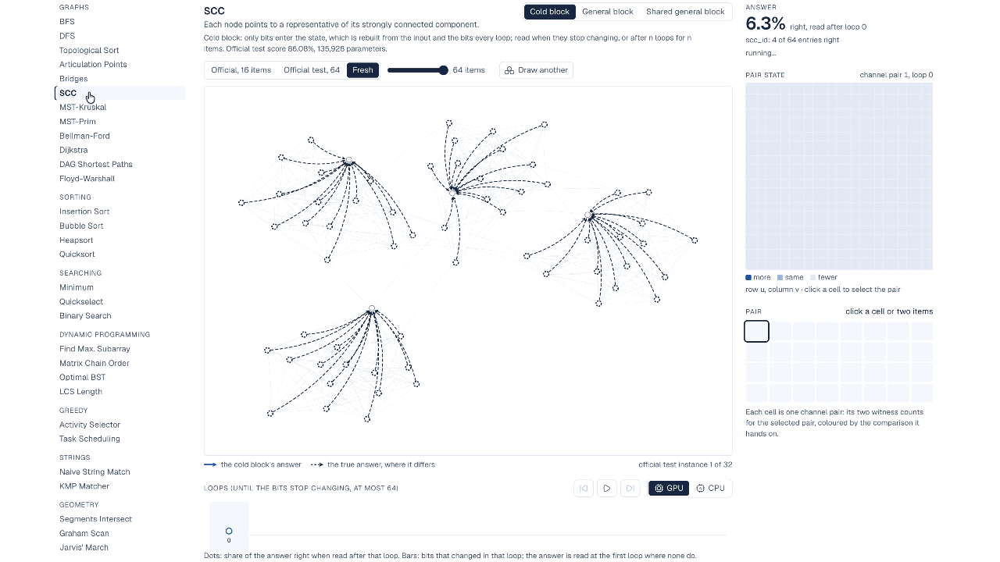

# Attention at Absolute Zero

<p align="center">
  <a href="https://neovand.github.io/cold-attention">
    
  </a>
</p>

<p align="center">
  <a href="https://arxiv.org/abs/2611.11937">Paper (arXiv:2611.11937)</a> ·
  <a href="https://neovand.github.io/cold-attention">Demo in the browser</a> ·
  <a href="https://huggingface.co/mohsenvand">Trained models</a>
</p>

Code, trained models and the demo page for the paper *Attention at Absolute Zero*
([arXiv:2611.11937](https://arxiv.org/abs/2611.11937), version 2). The demo runs every CLRS-30 task in your browser
with the trained blocks, at [neovand.github.io/cold-attention](https://neovand.github.io/cold-attention).

Attention scores the candidates that could support an answer, which we call witnesses, and reads those scores at a
temperature. The layer here keeps its state on pairs of items: for a pair (a, b), every third item k is a candidate
witness, judged through its two legs (a, k) and (k, b). It reads the witnesses at zero temperature, keeping the best
witness and the number of witnesses that tie with it, and passes on only bits that compare such counts. It is looped,
rebuilding its pair state from the input and these bits at every loop, and it is trained from answers alone.

## Results

| Task | Result |
|---|---|
| CLRS-30 (30 algorithms, trained without hints on at most 16 items, tested at 64), one **general block** shared by all 30 tasks | **97.20%** over three seeds (97.34, 97.26, 97.01) |
| one general block per task | 97.04% (three seeds) |
| each task in the setting the theory prescribes, on the benchmark's standard inputs | 97.98% (98.35% with two input changes) |
| FloydNet, one model per task, best of runs with and without hints (arXiv 2601.19094) | 96.64% |
| Maximum retrieval, trained on sets of 5 to 16 items | at least 99.95% of sets on every one of ten seeds, at every size up to 16,384 |
| 2-SAT and two-colouring, from yes-or-no answers | exact at 500 variables |
| Beside a frozen Qwen2.5-7B, family relations | exact at 1,000 statements after training on 16 |
| CLUTRR from text, model frozen, a small read-in trained | 33% (the model alone) to 65% |

The **general block** reads half its channels at zero temperature but embeds the input's numbers and carries a
real-valued state from loop to loop. The **cold block** lets numbers enter only as comparisons made inside the layer
and rebuilds its state from the input and its bits at every loop. The **general-and-cold block** runs a cold block beside
a general one. In the code and the model folders the general block is `census`; the cold blocks are `cold`,
`compare_first`, `pair_numbers` and `dp_program`; the general-and-cold block is `two_blocks` (folders `warm_plus_cold*`
in the eleven-task repository, where `warm` names the general block).

## Trained models (Hugging Face)

The models below were checked for exact reproduction with this code on the hardware they were trained on; each card
says how.

| Repository | What |
|---|---|
| [cold-attention-clrs30](https://huggingface.co/mohsenvand/cold-attention-clrs30) | one block per CLRS-30 task: the general block on all 30, the cold blocks on 18, three seeds |
| [cold-attention-clrs30-shared](https://huggingface.co/mohsenvand/cold-attention-clrs30-shared) | the shared general blocks (the paper's, `shared-units-dfs/`, and the first one, `shared/`), the general-and-cold shared block, a five-task block |
| [cold-attention-clrs30-eleven](https://huggingface.co/mohsenvand/cold-attention-clrs30-eleven) | the depth study: four shared blocks on eleven tasks, with the deeper test graphs |
| [cold-attention-clrs30-variants](https://huggingface.co/mohsenvand/cold-attention-clrs30-variants) | the per-task variants, controls and registered failures the paper reports (73 models) |
| [cold-attention-scc-committee](https://huggingface.co/mohsenvand/cold-attention-scc-committee) | strongly connected components with committee-chosen training |
| [cold-attention-max-retrieval](https://huggingface.co/mohsenvand/cold-attention-max-retrieval) | maximum retrieval: the cold pair count, its warm control and our softmax replication (40 models) |
| [cold-attention-csp](https://huggingface.co/mohsenvand/cold-attention-csp) | 2-SAT and two-colouring, with the evaluation instances |
| [cold-attention-organ](https://huggingface.co/mohsenvand/cold-attention-organ) | the block beside a frozen Qwen2.5 (kinship, comparison), its controls and its certificates |
| [cold-attention-clutrr](https://huggingface.co/mohsenvand/cold-attention-clutrr) | CLUTRR, from graphs and from text |
| [witness-clrs](https://huggingface.co/mohsenvand/witness-clrs) | an earlier release of the per-task CLRS-30 models, superseded by cold-attention-clrs30 |

The code and results of the paper's first version ("Attention Is Only as Good as Its Witnesses") are at
[github.com/NeoVand/witnesses](https://github.com/NeoVand/witnesses).

## Layout

The Python package keeps its working name, `witness_clrs`, which the Hugging Face cards' examples use.

```
witness_clrs/      the package: the block in every variant (model.py), inputs (data.py), the library's data
                   (generate.py) and the depth study's deeper pools and test graphs (pools.py), training of one task
                   (train.py) and of one shared block on many (train_shared.py; train_shared_rule.py with per-input
                   loops and a second block), the committee that chose the strong components' training graphs
                   (committee.py), the registered reads (evaluate.py), a copy of the library's scorer (scoring.py),
                   safetensors and Hugging Face loading (weights.py)
configs/           one configuration per task and block; shared/ the two shared blocks; csp/ the constraint problems
csp/               2-SAT, two-colouring and parity with a hidden twist: generators (with the standard routine, a brute
                   force and a decoder from the block's inputs), and the splits the paper uses (csp/generate.py)
max_retrieval/     maximum retrieval: the task, the networks, the reads and the training, in one file
organ/             the block beside a frozen language model: read-in, block, controls, Organ.ask (organ.py); training (train.py)
clutrr/            CLUTRR: the reader, the bit block, the cost read (clutrr.py); training of the blocks and the read-in (train.py)
lean/              the Lean 4 proofs of the organ certificates (OrganCert.lean, OrganTables.lean)
numbers/           every number the paper prints: recomputed from the released models, or read from measured files
scripts/           Modal apps (generate, train, check), the release checks, the library scorer, tables, the HF cards,
                   the demo page's assets (page_assets.py fetches its models from Hugging Face)
site/              the demo page (SvelteKit): every CLRS-30 task in the browser
tests/             python -m pytest tests
REPRODUCE.md       what was checked, how, and with what result
```

## Install

```bash
pip install -e .            # jax, optax, numpy, safetensors
pip install -e ".[hub]"     # to load the trained models from Hugging Face
```

Generating CLRS-30 data needs the library (`pip install dm-clrs==2.0.3`, which has its own dependencies; a separate
environment is simplest). The organ and CLUTRR readers need torch and transformers.

## Use a trained model

```python
from witness_clrs import load_hub, load_shared_hub, registered_read, score
from witness_clrs.data import load_split
d = load_split("data/dijkstra/test.npz")                       # python -m witness_clrs.generate data dijkstra test
params, cfg = load_hub("mohsenvand/cold-attention-clrs30", "census/dijkstra/seed0")
# or the shared general block:
# params, cfg = load_shared_hub("mohsenvand/cold-attention-clrs30-shared", "shared-units-dfs/seed0", "dijkstra")
outs = [(o["name"], o["kind"]) for o in cfg["outputs"]]
pred, loops = registered_read(params, cfg["model"], outs, d)
print(score(pred, d, outs))
```

Maximum retrieval: `python max_retrieval/max_retrieval.py demo cold_count/seed0 --sizes 16,4096`. The organ:
`python organ/organ.py demo`. Every Hugging Face card has its own example.

## Reproduce

```bash
python -m witness_clrs.generate data bfs test          # official test split (also: val, train:4 ... train:16)
python -m witness_clrs.train configs/census/bfs.json data runs/census/bfs/seed0 0
```

Training pools are 80,000 inputs per size; `modal run scripts/modal_app.py::generate_all` builds them in parallel and
`modal run scripts/modal_app.py::train_all --block census --seeds 0,1,2` trains the per-task general table (90 runs).
One general model trains in about 1.5 to 2 hours on an NVIDIA L4; the cold blocks stop within minutes, at the first
validation check that follows four in a row at 100%.

The shared general block trains every task at once:

```bash
python -m witness_clrs.train_shared configs/shared/units_dfs.json data runs/shared/seed0 0
```

(`configs/shared/shared.json` is the first shared block.) It takes about 13 hours on an NVIDIA B200
(`modal run scripts/modal_app.py::train_shared --config configs/shared/units_dfs.json --seed 0`). The depth study's
eleven-task blocks and the 30-task general-and-cold block read each input after its own loop count and add a second
block (`configs/shared/eleven_*.json`, `configs/shared/general_and_cold.json`); they also draw from deeper training
pools (`deep/`, `multi_entry/` in the data folder). `python -m witness_clrs.pools deep <data>/deep <task> train:<size>`
(or `big:<size>`) and `python -m witness_clrs.pools multi_entry <data>/multi_entry strongly_connected_components
train:<size>` build them (needs dm-clrs); `python -m witness_clrs.pools copy <data> <data>/deep <task>` (and the
same for `multi_entry`) adds the standard val and test files. The module's docstring describes every draw, and the
depth study's deeper test graphs.

Strong components with committee-chosen training graphs: `python -m witness_clrs.committee starts|walk|pack ...` builds
the pools (the walk on a GPU, reading the three released positions-compared models), then `witness_clrs.train` trains on
them.

The constraint problems: `python -m csp.generate data two_sat` writes every split (seconds to minutes per split), then
`python -m witness_clrs.train configs/csp/two_sat.json data runs/csp/two_sat/seed0 0` trains the cold block (about
half an hour on an NVIDIA H100; the paper's models are the weight-averaged parameters, written to `weight_averaged/`).

To check released models against their reference predictions: `modal run scripts/modal_app.py::check` (per-task),
`modal run scripts/modal_app.py::check_shared --gpu B200` (shared blocks), or locally
`python scripts/check_release.py <models dir> data`. Maximum retrieval retrains with `max_retrieval.train`. The Lean
proofs compile with Lean 4.35.0: `lean -o OrganCert.olean OrganCert.lean && lean OrganTables.lean` in `lean/`.

[REPRODUCE.md](REPRODUCE.md) lists every check and its result, and which trainers are verified to reproduce the
released weights bit for bit.

## The paper's numbers

`python numbers/numbers.py` prints each of the 1,433 numbers the paper prints beside the paper's value. 845 are
recomputed, 683 from the released models' scores and 162 from published sources, and all 845 equal the paper's.
The other 588 are measurements that are not stored model scores. They are read from 27 files of measured values in
`numbers/data/measured/`, named by family; [numbers/README.md](numbers/README.md) lists them.

The paper's figures are built from the released results. Their plotting scripts are not in this repository.

## Demo

`site/` is the demo page: every CLRS-30 task in the browser, an official instance or a fresh one at any size, the
trained block (per task, or the shared general block) running in the page, its loops, and the witnesses of any pair you
click. See [site/README.md](site/README.md). The page's engine gives the same answers as this package on the official
instances.

## Citation

```bibtex
@misc{mohsenvand2026absolutezero,
  title         = {Attention at Absolute Zero},
  author        = {Mohsenvand, Mostafa},
  year          = {2026},
  eprint        = {2611.11937},
  archivePrefix = {arXiv},
  primaryClass  = {cs.LG},
  url           = {https://arxiv.org/abs/2611.11937}
}
```

## License

Apache 2.0.
